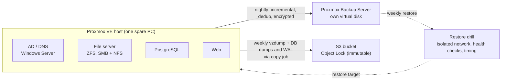

# RestorePoint

A small virtualised company whose backups are actually tested, so disaster recovery is a measured drill, not a hope.

> **Status: in progress.** Every number below is either a *target* (from the design) or a *measured result* with a link to the evidence behind it. Nothing is claimed until it has been measured. See [`evidence/`](evidence/).

## The problem

Most small IT teams have backups but have never restored from them under time pressure. That leaves three hidden problems:

- **Guessed recovery numbers.** The DR plan claims times nobody has measured.
- **Weak offsite copies.** Missing, unencrypted, or deletable by ransomware.
- **Silent failure.** Storage fills up unnoticed until a backup job fails.

RestorePoint's answer: a backup that has never been restore-tested is a hope, not a control. It backs up with encryption and an immutable offsite copy, then **restores automatically every week** and measures the result.

## Architecture



| Layer | Choice |
|---|---|
| Virtualisation / storage | Proxmox VE 9.2, ZFS, LVM thin pools, Samba (SMB) and NFS |
| Backup | Proxmox Backup Server 4.2, `vzdump`, `pg_dump` + WAL archiving |
| Offsite | AWS S3 with Object Lock (compliance mode) |
| Automation | Bash and Ansible; Linux, Windows Server AD/DNS |
| Monitoring | Capacity dashboard with days-until-full forecast |

## Targets and results

| Goal | Target | Measured | Evidence |
|---|---|---|---|
| Full-VM restore from local backup | under 15 min | pending | |
| Database recovery to a chosen point in the last 7 days | RPO of 5 min or less | pending | |
| Dedup ratio | 3:1 or better | pending | |
| Restore drills passing | all drills in the measured window | pending | |
| Full site-loss rebuild from the offsite copy | under 90 min | pending | |

The design targets 4 weeks of passing weekly drills. The build window is shorter than that, so the result will be reported as *N drills over D days*, and the weekly schedule keeps running after the build.

## Design decisions

Each significant choice is written up in [`decisions/`](decisions/) with context, options and the trade-off accepted.

| # | Decision | Status |
|---|---|---|
| [0001](decisions/0001-immutable-offsite-copy.md) | Immutable offsite copy via vzdump and DB files in a locked bucket, not PBS-native | Accepted |
| [0002](decisions/0002-windows-server-ad.md) | Windows Server AD from an evaluation ISO | Accepted |
| [0003](decisions/0003-nested-virtualised-lab.md) | Run the lab nested in a VM on the workstation | Accepted |

## Lab notes

- The lab runs nested in a VM on a single workstation, so timings show the method rather than production capacity.
- PBS S3 datastores don't support Object Lock, so the immutable offsite copy is a separate, non-deduplicated copy job ([decision 0001](decisions/0001-immutable-offsite-copy.md)).
- The site-loss rebuild restores from the S3 copy onto a fresh Proxmox install.

## Roadmap

| Phase | Gate | Status |
|---|---|---|
| 0. Foundation: nested Proxmox VM | Nested virtualisation works, web UI reachable, versions recorded | Not started |
| 1. Storage and VMs | Pools healthy, quotas set, four VMs boot, baseline data sizes recorded | Not started |
| 2. Local backups | Full and incremental backups, dedup ratio measured, manual restore works | Not started |
| 3. PostgreSQL point-in-time recovery | Restore to a chosen timestamp, row count verified | Not started |
| 4. Immutable offsite | Delete attempt on a locked object fails | Not started |
| 5. Automated restore drill | Restore, health checks and timing logged; a failed check is detected | Not started |
| 6. Site-loss runbook and capacity forecast | Timed rebuild recorded; days-until-full computed from measured growth | Not started |

## Repository layout

```
decisions/   Architecture decision records
evidence/    Dated test output behind every claim, passing and failing runs
docs/        Runbooks and diagrams (added as they are written)
```

Scripts, Ansible roles and configuration are added phase by phase.
