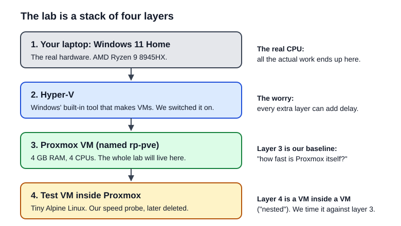
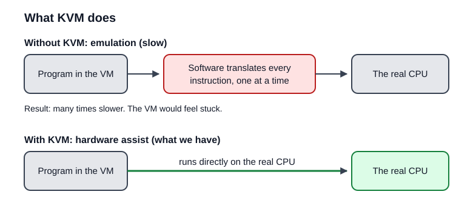
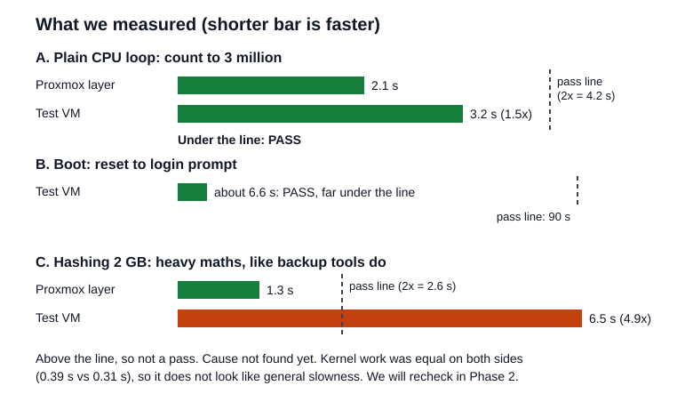
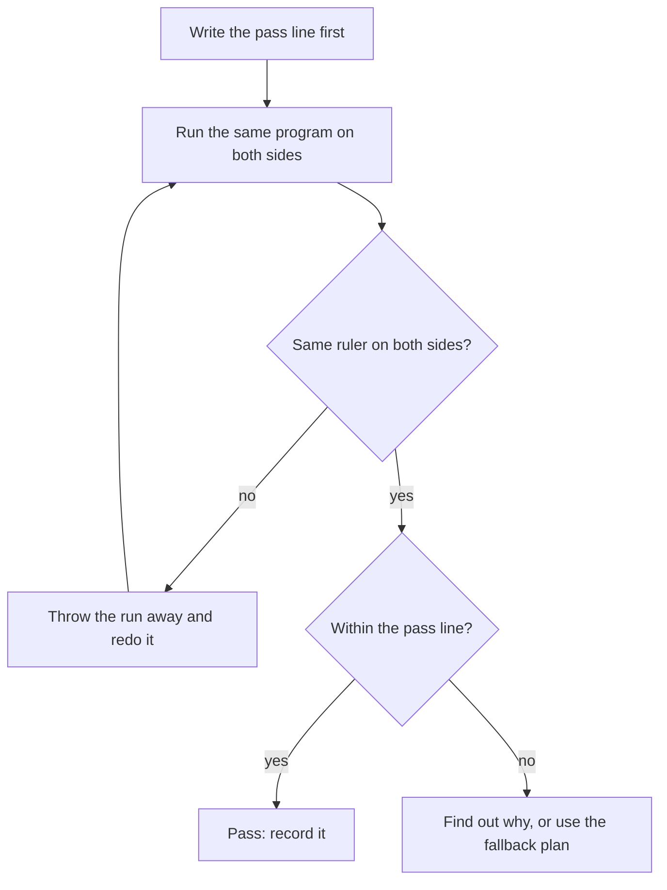

# Phase 0 explained: why we tested speed

A plain-language guide to what Phase 0 proved and why. No prior virtualisation knowledge needed.

## The one-minute version

RestorePoint runs a pretend company on **Proxmox**. Proxmox itself runs inside a virtual machine (VM) on one laptop, because the laptop has a single disk and wiping it was off the table ([decision 0003](../decisions/0003-nested-virtualised-lab.md)). That is called **nested virtualisation**: a VM inside a VM.

The risk is simple. Every extra layer can slow things down. If the lab is too slow, two things go wrong:

- the restore times we measure would not mean much, and
- the VMs created later (database, file server, restore-drill targets) could hang or crawl.

So before building anything, we ran a few small tests. **Result: it is fast enough.** The details are below, including the one result that is still unexplained.

## Words you will meet

| Word | What it means here |
|---|---|
| **VM** | A pretend computer running as a program inside a real one. |
| **Hypervisor** | The program that makes VMs. On the laptop it is **Hyper-V**, which comes with Windows. |
| **Nested** | A VM running inside another VM. Layers 3 and 4 in the picture. |
| **KVM** | A Linux feature that lets a VM use the real CPU directly. Without it, a VM has to *imitate* a CPU in software, which is many times slower. See the picture below. |
| **Baseline** | The speed of the layer underneath, measured first. A number only means something compared to something. |
| **BusyBox** | One small program that contains lots of basic Linux commands (`dd`, `sha256sum`, a shell). We used it as an identical ruler on both sides, so the two runs executed the same kind of code. |
| **Pass line** | A limit written down before measuring, so we cannot move the goalposts afterwards. |

## What each test does

| Test | In plain words | The question it answers | Result |
|---|---|---|---|
| `/dev/kvm` exists, `svm` flag on every CPU | Does the door to hardware assist exist inside Proxmox? | Can nested VMs use hardware assist at all? | Yes, on 4 of 4 CPUs ([evidence](../evidence/phase-0-foundation/2026-11-13T1658-nested-kvm-check.md)) |
| Test VM shows the real CPU name; QEMU holds KVM handles | Is the test VM really using hardware assist, or imitating? | Is it emulated? | Not emulated: real CPU name, 4 KVM handles ([run 3](../evidence/phase-0-foundation/2026-11-13T1734-nested-speed-test-v3.md)) |
| Plain CPU loop (count to 3 million) | Pure thinking, no special tricks. | How much slower is raw CPU work inside the test VM? | 1.5x slower, pass line 2x: **pass** |
| Boot time after a reset | How long until the VM is usable. | Does it feel responsive? | About 6.6 s, pass line 90 s: **pass** |
| Hashing 2 GB (SHA-256) | Heavy maths, like backup tools do. | Will backup-style work crawl? | 4.9x slower, pass line 2x: **not a pass, cause not found** |
| `pveperf`, idle memory | Baseline numbers for Proxmox itself. | What do we compare against later? | Recorded ([run 1](../evidence/phase-0-foundation/2026-11-13T1713-nested-speed-test-v1.md)) |

**About the odd one out.** The hashing test is slower in the test VM than our pass line allows, and we do not know why yet. What we do know: time spent in the operating system's own work was nearly equal on both sides (0.39 s vs 0.31 s), the plain CPU loop is fine, and the test VM does have the CPU's hashing instructions. The most likely cause is that the two copies of BusyBox are built differently, but that is unverified. It matters most for backup speed, so it is rechecked in Phase 2 with the real backup tool.

## How we decide what counts

1. **Pass line before measuring.** No changing the target after seeing the result.
2. **Same ruler on both sides.** Our first comparison used different programs on each side, so we threw it away and redid it ([run 1](../evidence/phase-0-foundation/2026-11-13T1713-nested-speed-test-v1.md), [run 2](../evidence/phase-0-foundation/2026-11-13T1725-nested-speed-test-v2.md)).
3. **Split the time.** "Kernel time" is the operating system's own work; "user time" is the program's maths. Seeing which one is slow tells us where the slowness lives.
4. **Keep failed runs.** They are in the evidence folder, next to the passes.
5. **Only measured numbers are claimed.** Targets in the README stay marked as targets until measured.

## What went wrong on the way

| Problem | Cause | Fix |
|---|---|---|
| Installer could not find its own disc on a Generation 2 VM | The installer's early boot lacks the Hyper-V driver for that kind of virtual drive ([log](../evidence/phase-0-foundation/2026-11-13T1639-gen2-installer-no-iso.md)) | Use a Generation 1 VM |
| Graphical installer crashed on Generation 1 | Hyper-V's Generation 1 video device does not suit the installer's graphics ([log](../evidence/phase-0-foundation/2026-11-13T1648-gen1-graphical-installer-fails.md)) | Use the text-mode installer |
| VirtualBox could not do nested virtualisation | Windows' own hypervisor already holds the CPU ([decision 0004](../decisions/0004-hyperv-as-nested-lab-hypervisor.md)) | Use Hyper-V instead |

## What this means for the rest of the project

- Test VMs boot in seconds and run ordinary work at about 1.5x the time of the layer underneath. That is fine for a lab.
- Timings in this repo are measured on a nested lab, and the README says so in one line. They show the method, not production capacity.
- One question stays open: hashing speed, to be rechecked when real backups run in Phase 2.
